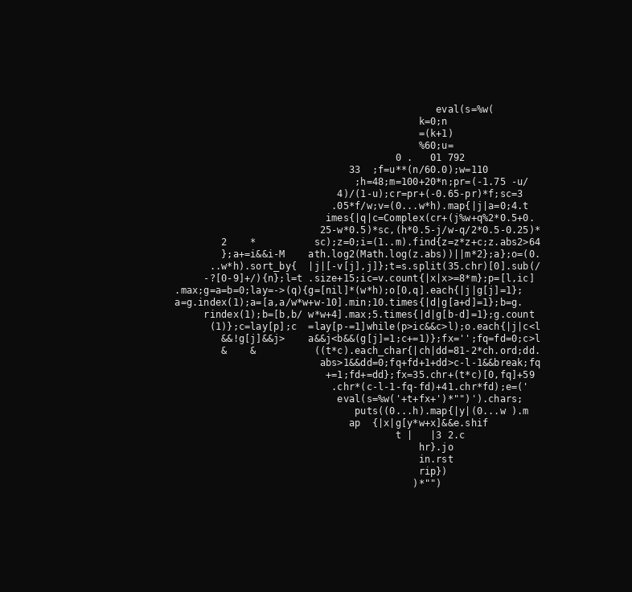

# mandelquine

A Ruby program whose source code is laid out in the shape of the Mandelbrot
set. Running it prints another program, shaped like the set zoomed in about
6.5%. After 60 runs the output is byte-identical to the original.



## Run it

```bash
cp mandelquine.rb ruby.rb
while ruby ruby.rb | sponge ruby.rb; do clear; cat ruby.rb; done
```

`sponge` is from moreutils (`brew install moreutils`). `mandelquine.cast` is
an asciicast of the same thing: `asciinema play mandelquine.cast`.

## How it works

- The file is `eval(s=%w( ... )*"")`. `%w` splits on whitespace and `*""`
  joins it back, so the code can be broken at any character and still run,
  and `s` holds the program's own source.
- Each run scores every cell of a 110x48 grid by smooth escape time, then
  fills exactly as many cells as the next program has characters: interior
  cells first, then the closest exterior cells.
- When the interior is larger than the program, the surplus is a trailing
  comment holding a second copy of the code, cut where its parentheses can
  be closed so `%w(` still terminates.
- The zoom is about the fixed point of the affine map that sends the whole
  set onto the period-3 minibrot on the real axis, scaled so generation 60
  frames the minibrot the way generation 0 frames the whole set. The counter
  is `(k+1)%60`, which is what makes the cycle close exactly.

## Rebuild

`src/body.rb` is the program before layout. `python3 src/build.py` strips its
whitespace, runs 61 generations, checks that generation 60 equals generation
0, and renders the GIF (needs Pillow). `python3 src/mkcast.py mandelquine.rb
mandelquine.cast` regenerates the cast.
